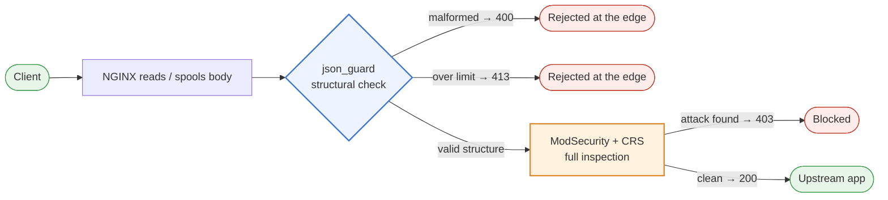
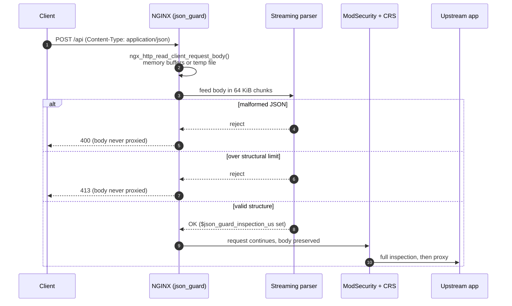
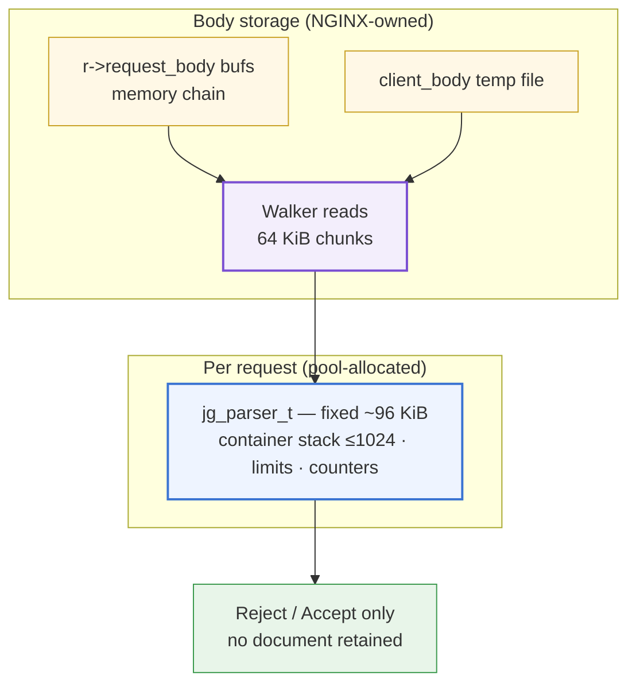
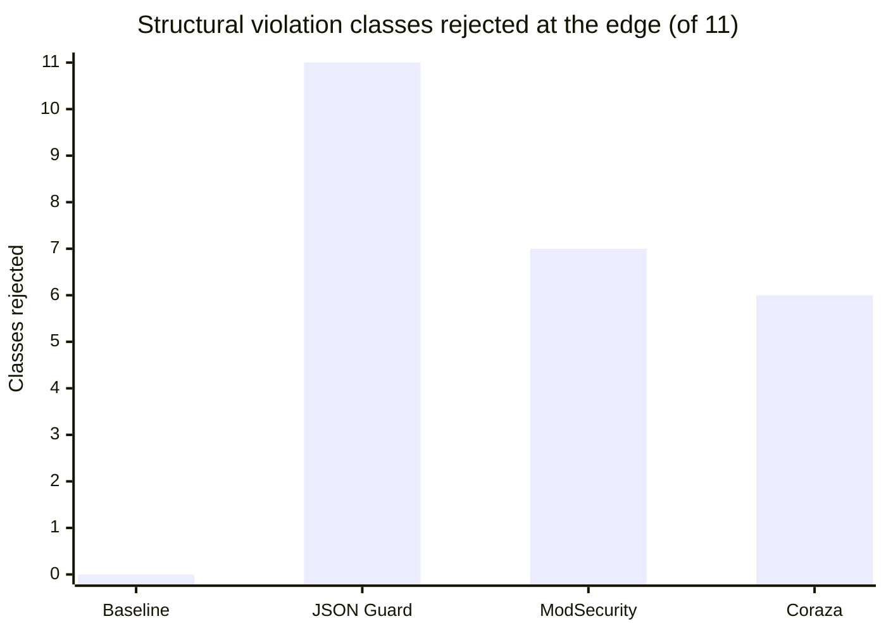
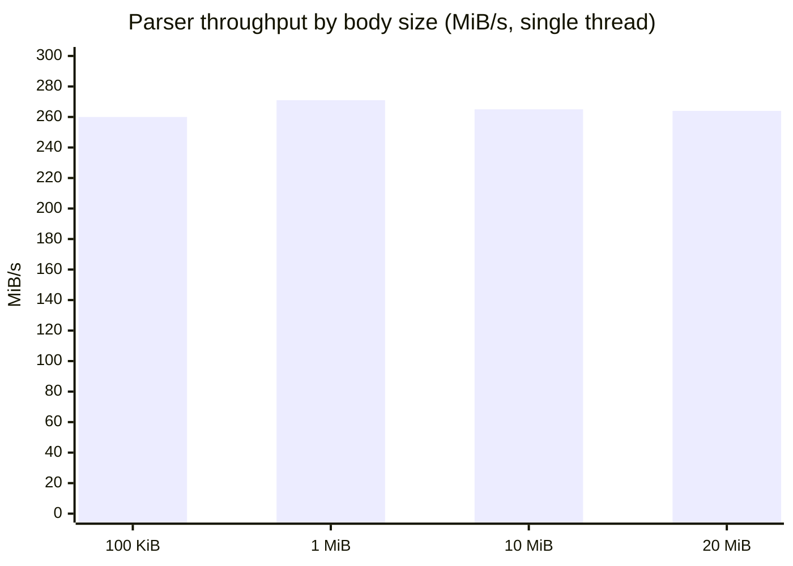
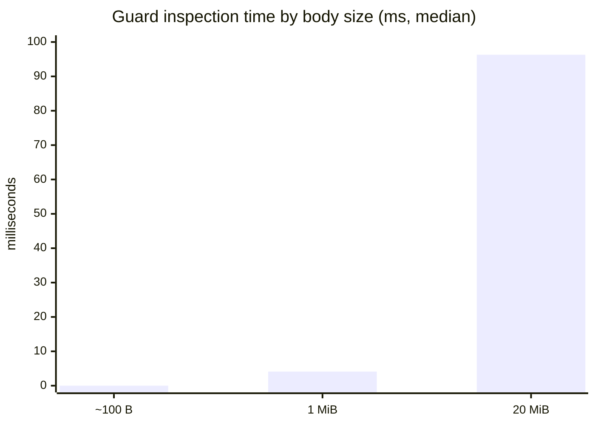
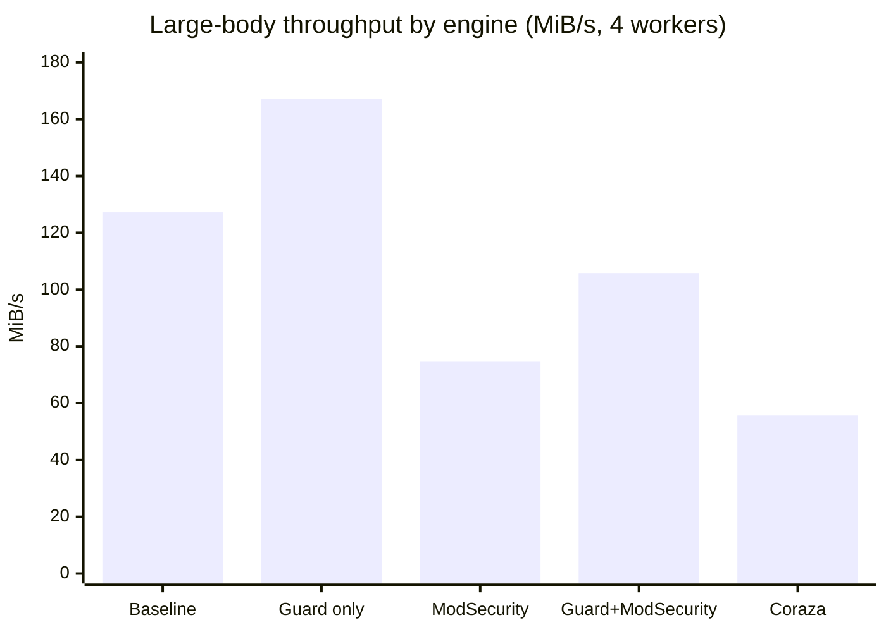
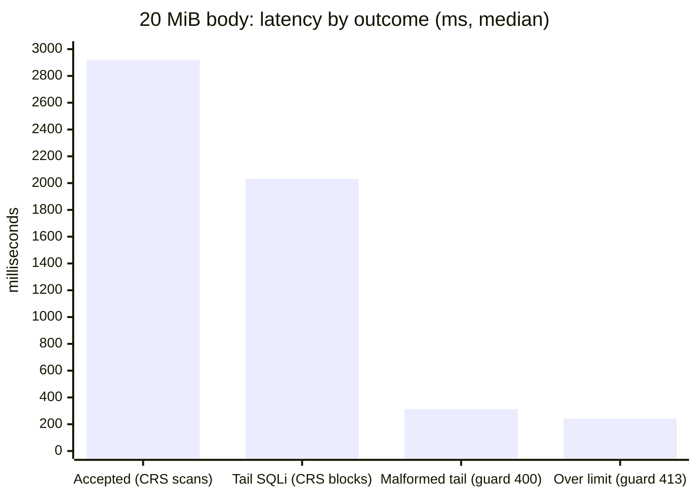

# Diagram sources (Mermaid)

Single source of truth for every diagram rendered in the documentation
site (`docs-site/`). Each diagram below is hand-authored Mermaid — no
AI-diagram service was used to generate or render them. The Docusaurus
site renders these blocks client-side via `@docusaurus/theme-mermaid`;
GitHub renders the same blocks natively in this file.

> Note: the original request was to draw these with the Eraser MCP and
> export as Mermaid. That MCP server is not connected in this
> environment, so the diagrams were written directly as Mermaid source —
> which is the same format Eraser exports. If the Eraser MCP becomes
> available, these sources can be round-tripped through it unchanged.

Chart data comes exclusively from the 2026-08-24 benchmark runs
(`BENCHMARK.md`, commit `08851ee`).

---

## 1. Request architecture

*Used on: Why it was built.*

## 2. Request lifecycle (sequence)

*Used on: How it works.*

## 3. Memory model

*Used on: How it works.*

## 4. Structural classes rejected at the edge

*Used on: Engine comparison.* Count of violation classes (of 11) each
engine rejects itself, from the 51-case structural corpus.

## 5. Parser throughput by body size

*Used on: Performance results.* Median of 15 passes, single thread,
idle host.

## 6. Guard inspection time by body size

*Used on: Performance results.* `$json_guard_inspection_us`, median,
guard + ModSecurity + full CRS, 4 workers.

## 7. Large-body throughput by engine

*Used on: Performance results.* Processor suites, 4 workers. Guard-only
exceeds baseline because the corpus contains bodies the guard rejects
early; baseline must proxy every byte.

## 8. 20 MiB body latency by outcome

*Used on: Performance results.* Median latency: accepted vs CRS-blocked
vs guard-rejected.

---

### Style conventions used

- Flowcharts: rounded `([...])` terminals for actors/outcomes, straight
  `[...]` for processing stages, `{...}` for decisions; three-color
  semantic palette (blue = guard, orange = ModSecurity/CRS, red = reject,
  green = pass-through) applied via `classDef`-equivalent inline `style`.
- Sequence diagrams: `autonumber`, `alt` lanes for the three validation
  outcomes, ` ` for two-line labels to keep frames narrow.
- Charts: `xychart-beta` bars, y-axis maxima set one round step above the
  tallest bar so labels never clip.
