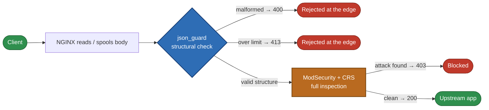
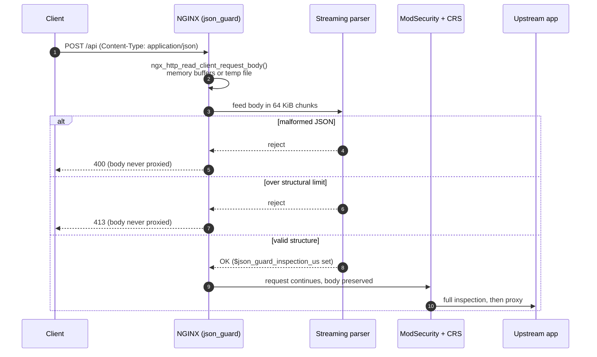
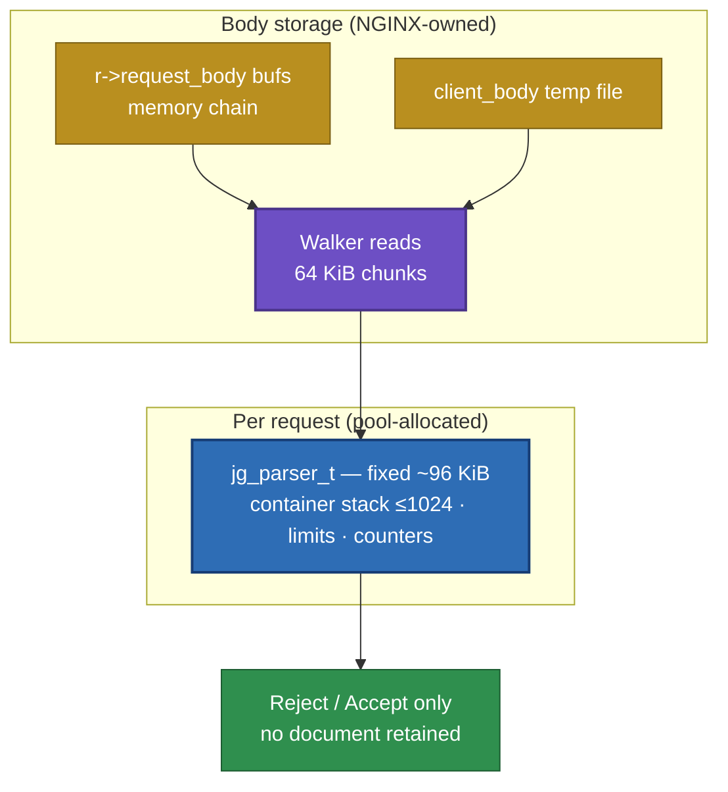
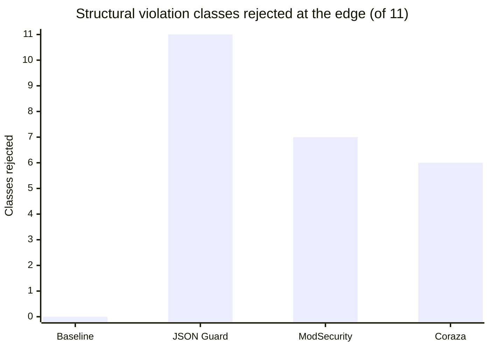
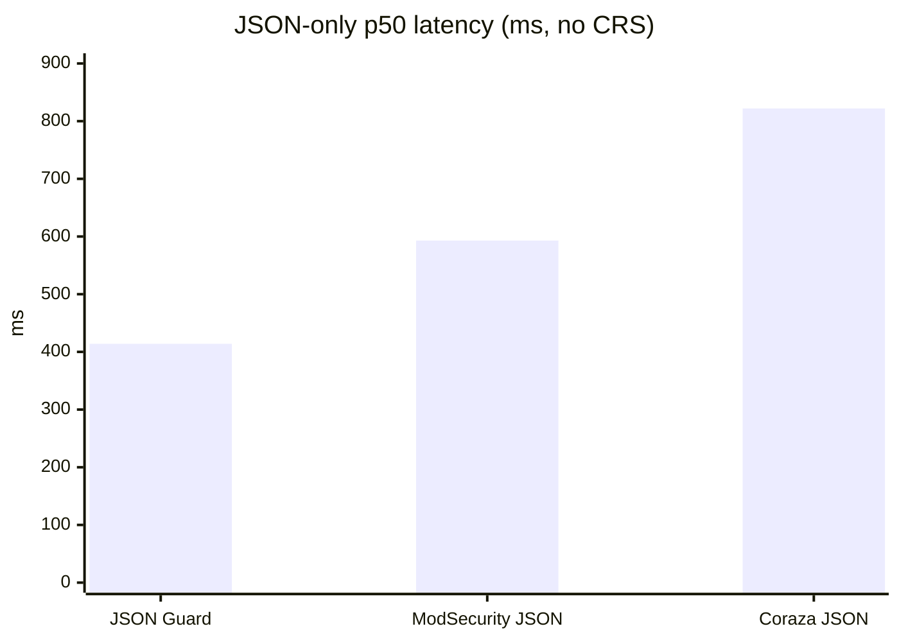
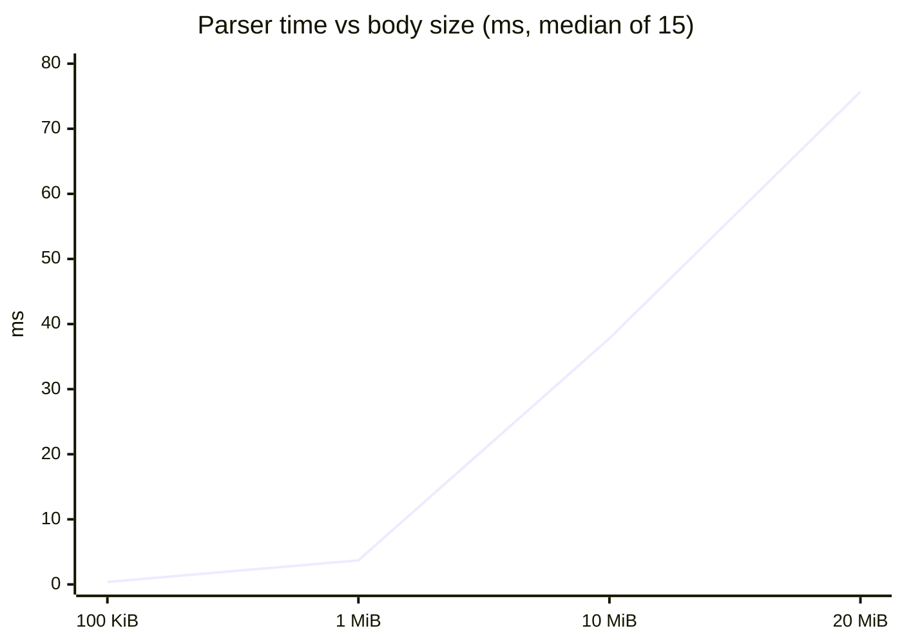
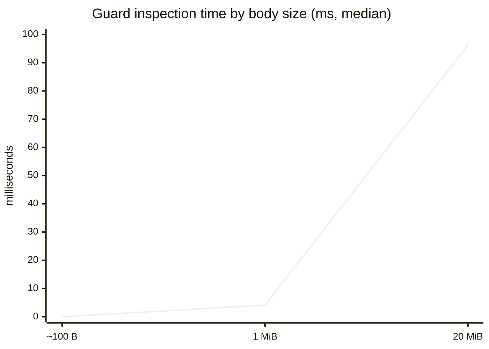
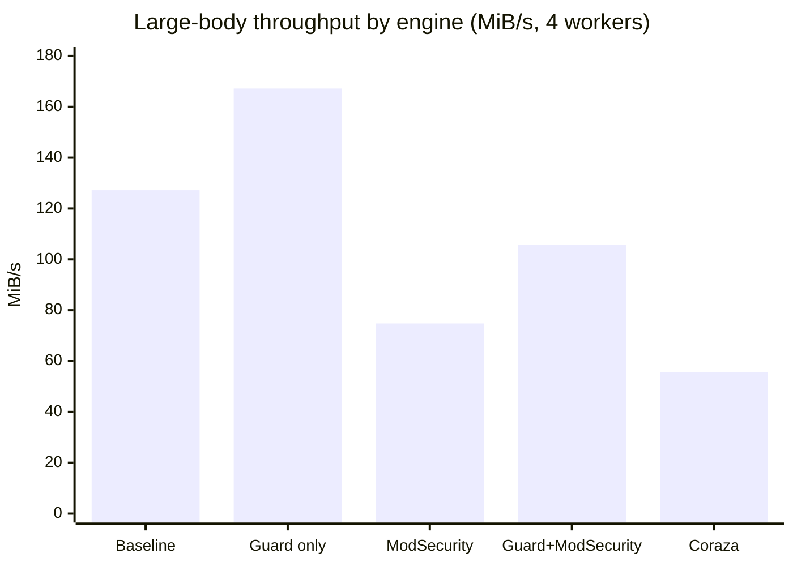
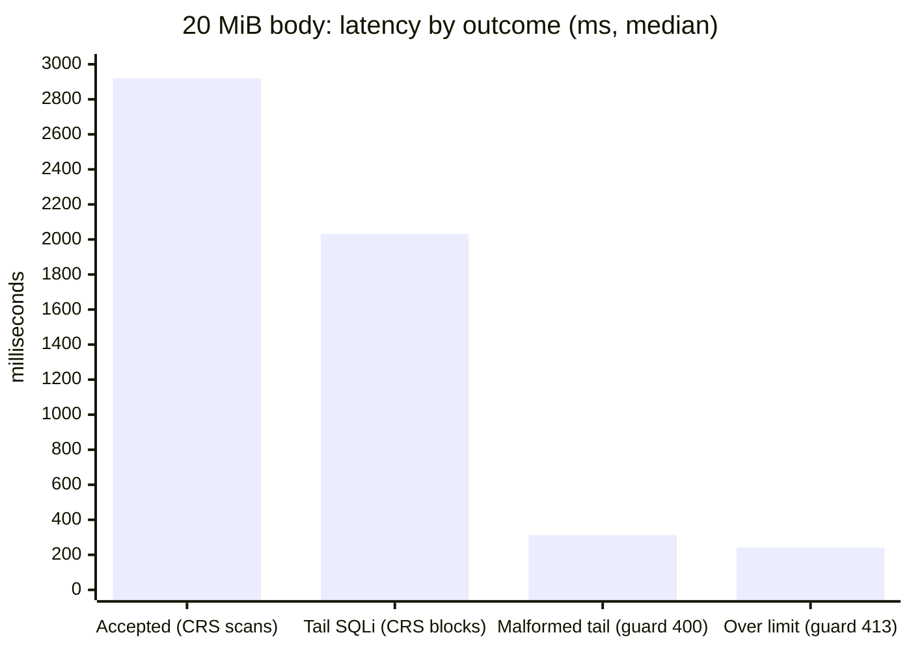

# Diagram sources (Mermaid)

Single source of truth for architecture diagrams rendered in the
documentation site (`docs-site/`). Benchmark *charts* on the docs site
are SVG (numeric axes, including log-x for inspection time) so body size
is not plotted as equally spaced categories. Mermaid `xychart-beta` below
is kept for GitHub rendering of the same published numbers.

Chart data comes exclusively from the 2026-08-24 benchmark runs
(`BENCHMARK.md`, commit `08851ee`). No values were changed for display.

---

## 1. Request architecture

*Used on: Why it was built.*

## 2. Request lifecycle (sequence)

*Used on: How it works.*

## 3. Memory model

*Used on: How it works.*

## 4. Structural classes rejected at the edge

*Used on: Engine comparison.* Count of violation classes (of 11) each
engine rejects itself, from the 51-case structural corpus.

## 4b. JSON-only time: Guard vs ModSecurity vs Coraza

*Used on: landing, Comparison, Performance.* Processor-only profiles,
no CRS. Client-observed p50 on the mixed 1–100 MiB corpus.

p95 on the same profiles: 2579 / 6526 / 7894 ms. Throughput: 167.2 /
74.8 / 55.7 MiB/s.

## 5. Parser time vs body size

*Used on: Performance results (docs site uses an SVG line with numeric
x). Median of 15 passes, single thread, idle host.*

Throughput over the same points stays flat (260, 271, 265, 264 MiB/s).

## 6. Guard inspection time by body size

*Used on: Performance results.* `$json_guard_inspection_us`, median,
guard + ModSecurity + full CRS, 4 workers.

## 7. Large-body throughput by engine

*Used on: Performance results.* Processor suites, 4 workers. Guard-only
exceeds baseline because the corpus contains bodies the guard rejects
early; baseline must proxy every byte.

## 8. 20 MiB body latency by outcome

*Used on: Performance results.* Median latency: accepted vs CRS-blocked
vs guard-rejected.

---

### Style conventions used

- **Dual-theme safety first.** The docs site renders diagrams in both a
  light and a dark Mermaid theme; theme-level `themeVariables` are *not*
  shared between them. Styled nodes therefore use saturated mid-tone
  fills with explicit white text (`fill:#…,color:#ffffff`) so they stay
  readable on white and near-black page backgrounds alike. Pastel fills
  are avoided on purpose — they break in dark mode.
- Flowcharts: rounded `([...])` terminals for actors/outcomes, straight
  `[...]` for processing stages, `{...}` for decisions; semantic palette
  (blue = guard, orange = ModSecurity/CRS, red = reject, green =
  pass-through, purple = walker, amber = body storage).
- Sequence diagrams: `autonumber`, `alt` lanes for the three validation
  outcomes, ` ` for two-line labels to keep frames narrow.
- Charts: GitHub still uses `xychart-beta` (bar for categories, line for
  size series). The docs site plots the same numbers as SVG so the x axis
  can be proportional (or log) in body size. Y-axis maxima stay one round
  step above the tallest value so labels never clip.
