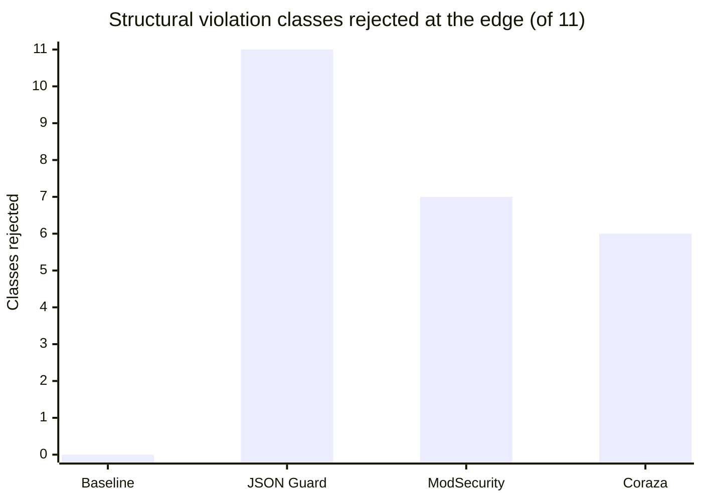

# Engine comparison: structural validation

Four engines were run against the same 51-case structural corpus on the
same host, each in its own container constrained to 2 vCPU / 4 GiB
(NGINX 1.26.2, libmodsecurity 3.0.13, Coraza 3.7.0 via Caddy 2.11.3,
CRS 4.25.0; run of 2026-08-24, commit `08851ee`):

| Engine | What it is |
|---|---|
| **Baseline** | plain NGINX, no JSON processing at all |
| **JSON Guard** | NGINX + `ngx_json_guard` (this module) |
| **ModSecurity standalone** | NGINX + ModSecurity JSON body processor, no rules |
| **Coraza** | Caddy + Coraza JSON body processor, no rules |

The question is narrow on purpose: **when a structurally invalid or
abusive JSON body arrives, who rejects it at the edge — and who lets it
through?**

## Structural validation matrix

Every cell is what the *proxy* did. "Pass" means the body was forwarded;
the test upstream also parses JSON, so some forwarded bodies were
eventually rejected by the *application* — that is the baseline's row in
a nutshell: it validates nothing itself.

| Violation class | Baseline | JSON Guard | ModSecurity | Coraza |
|---|---|---|---|---|
| Malformed syntax (trailing comma, bad brackets) | pass | **400** | **400** | **400** |
| Invalid escape / invalid number | pass | **400** | **400** | **400** |
| Invalid UTF-8 in strings | pass | **400** | **400** | pass |
| Unpaired UTF-16 surrogate (`"\ud800"`) | pass | **400** | pass | pass |
| Trailing garbage after document | pass | **400** | **400** | **400** |
| Nesting depth &gt; 100 | pass | **413** | 400† | 400† |
| Array/object width &gt; 10,000 | pass | **413** | **413** | **413** |
| Key length &gt; 4096 | pass | **413** | pass | pass |
| Number length &gt; 256 | pass | **413** | pass | pass |
| String length &gt; 64 MiB | pass | **413** | pass | pass |
| Total tokens &gt; 100,000 | pass | **413** | pass | pass |
| **Classes caught at the edge (of 11)** | **0** | **11** | **7** | **6** |

† ModSecurity's and Coraza's depth/width rejections come from *their own
fixed internal parser limits*, which you cannot configure. The guard's
thresholds are directives in `nginx.conf`.

Three takeaways:

1. **Everyone catches plain syntax errors.** If malformed JSON were the
   only concern, any JSON-aware engine would do.
2. **Only the guard has configurable structural limits.** Depth, key,
   number, string, token and width limits are nginx directives — the
   other engines either hardcode a threshold or have none, so a 5,000-deep
   nest or a 100 MiB single string reaches their parser (and your app)
   unless you add this layer.
3. **The guard is the only engine rejecting unpaired surrogates.** That
   is strict RFC 8259 behavior; the others tolerate it. Know your
   producers — if yours emit lone surrogates legitimately, do not enable
   that path without checking (there is no off switch; it is inherent to
   strict validation).

## What rejection costs

From the processor suites (20 MiB bodies, medians):

| Case | JSON Guard | ModSecurity alone | Guard + ModSecurity |
|---|---:|---:|---:|
| Clean 20 MiB, accepted | 476 ms | 696 ms | 829 ms |
| Malformed tail 20 MiB, rejected | 395 ms | 542 ms | **323 ms** |
| High-cardinality 20 MiB, accepted | 294 ms | 515 ms | 519 ms |

Reading: with the guard first, a malformed 20 MiB body is rejected **40%
faster** than ModSecurity's processor manages alone (323 vs 542 ms) — the
guard's walk is cheaper than a full libmodsecurity parse, and rejected
bodies skip rule evaluation entirely. The honest counterweight: an
*accepted* body is validated twice (guard, then processor), costing ~19%
more end-to-end in the processor-only configuration.

## With full CRS in front of large JSON

Under full CRS 4.25.0 with 20 MiB bodies, adding the guard in front does
not change CRS throughput (1.77 vs 1.80 MiB/s — noise) and cuts the
structural-correctness suite wall time from 150 s to 104 s, because
malformed bodies are 400'd before rules run. A single 64 MiB string under
full CRS: **268 s with Coraza vs 46.6 s with ModSecurity** — both
dominated by rule evaluation over the huge value, which is exactly the
workload class the guard's `json_guard_max_string_length` lets you cap
before any engine starts.

The complete methodology, raw tables, and reproduction steps are in
`BENCHMARK.md` in the repository root, and the headline numbers are on the
[Performance](/docs/performance/results) page.
