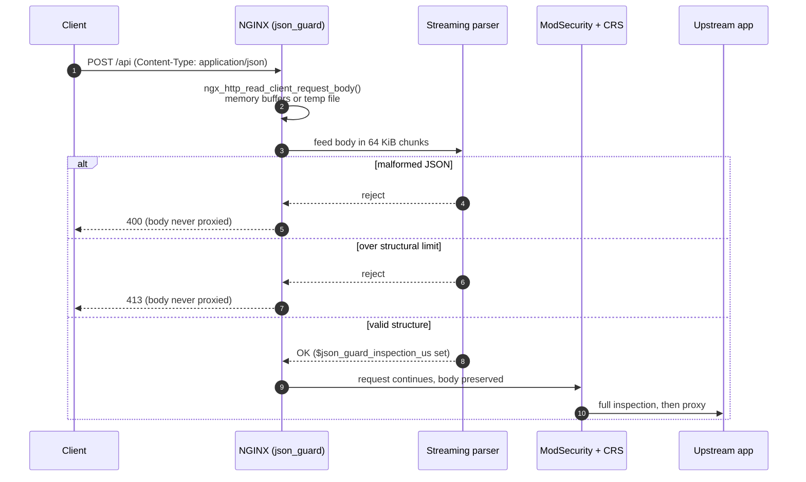
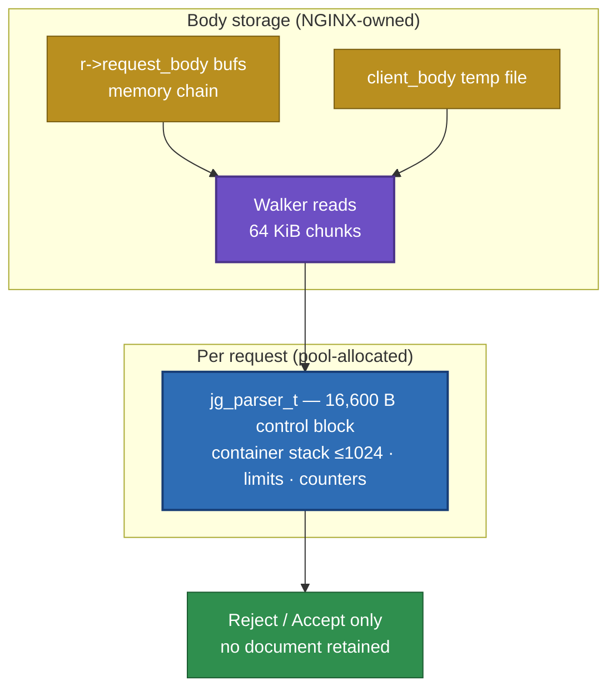

# How it works

`ngx_json_guard` hooks the PREACCESS phase and validates the JSON request
body *after* NGINX has read or spooled it, *before* ModSecurity or the
proxy see the request.

## Request lifecycle



Three properties of this flow matter:

- **Same body path as everything else.** The module calls
  `ngx_http_read_client_request_body()` — the canonical NGINX API — and
  then walks the resulting buffer chains (and temp file, if the body was
  spooled to disk). No second read, no body duplication.
- **The body is preserved.** Validation is read-only. When the guard
  accepts, `r->request_body` is intact and ModSecurity inspects the exact
  bytes the client sent — verified by SHA-256 digests at the upstream in
  the benchmark harness.
- **Rejections are cheap.** A rejected body never reaches rule evaluation
  or the upstream: a malformed 20 MiB tail is answered in ~313 ms versus
  ~2.9 s for a full CRS scan of an accepted body.

## Module ordering with ModSecurity

The guard must run *before* ModSecurity in the PREACCESS phase. The
supported arrangement loads the guard module first:

```nginx
load_module modules/ngx_http_json_guard_module.so;   # first
load_module modules/ngx_http_modsecurity_module.so;  # second
```

Textual `load_module` order is not a portable guarantee — NGINX reverses
phase-handler registration arrays — so the Docker build re-tests effective
ordering with the exact binaries it ships. Do the same for your own
deployment: send a structurally invalid JSON request and confirm the
response is the guard's 400, not a ModSecurity response.

## Memory model



Nesting beyond the internal hard ceiling (1024) is clamped at
configuration time — a `json_guard_max_depth 100000` directive cannot
overflow the fixed stack; it is capped to the ceiling. Duplicate-key
detection, when enabled, uses a 1024-slot fingerprint table allocated
only for that request and fails closed with `JG_REJECT_DUP_TABLE` if the
table is exceeded.

## Validation semantics

Strict RFC 8259-style structure:

- Objects, arrays, and (optionally) a top-level scalar.
- Strict strings: control characters, invalid escapes, invalid `\u`
  escapes, invalid UTF-8, and unpaired surrogates are rejected. Note
  libmodsecurity and Coraza both *tolerate* unpaired surrogates — the
  guard is deliberately stricter.
- Strict numbers: leading zeros, lone minus, `1.`, `1e}` are rejected.
- One document per body: trailing garbage after the top-level value is
  rejected.

Read the [NGINX configuration reference](/docs/configuration/nginx) for every
directive and default, or head to the
[engine comparison](/docs/comparison/engines) to see these semantics measured
against ModSecurity and Coraza.
