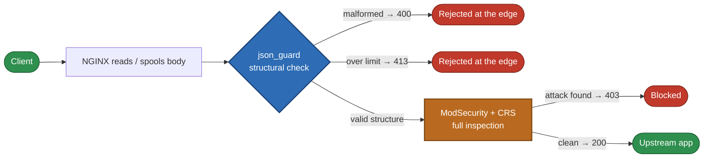

# Why ngx_json_guard was built

Large JSON request bodies put WAF operators in a lose-lose position. This
module exists to make that position winnable.

## The problem

Modern APIs routinely accept JSON bodies that are megabytes in size — batch
imports, ML feature vectors, base64-encoded files, GraphQL documents with
thousands of fields. If you run a WAF in front of such an API with
ModSecurity and the OWASP Core Rule Set, you have three bad options:

1. **Raise `SecRequestBodyLimit` and hope.** Full inspection stays on, but
   every oversized body now stresses the rule engine: deeply nested or
   pathological JSON can burn CPU in the parser before rules even run, and
   malformed bodies waste a full scan.
2. **Enable partial processing (`ProcessPartialLimit`).** You cap the
   inspected prefix and simply never see attacks planted past the cutoff.
   An SQL injection in the last kilobyte of a 20 MiB document sails
   through uninspected.
3. **Skip JSON body inspection.** All the detection power of CRS applies
   only to headers and query strings.

There was no cheap, dedicated layer that answers one narrow question
*before* the expensive engine runs: **is this body well-formed JSON with a
sane structure?**

## The answer

`ngx_json_guard` is an NGINX C module that validates JSON request bodies
with a streaming, non-recursive parser after NGINX has read or spooled
them, and enforces configurable structural limits — nesting depth, string
and key lengths, token counts, object and array widths. Malformed JSON
gets a **400**. Structurally abusive JSON gets a **413**. Everything else
passes through untouched, body fully preserved for ModSecurity.

The measurements behind this picture are in
[Performance](/docs/performance/results): the guard's own cost is about
**0.67% of a full CRS scan** on an accepted 20 MiB body, roughly
**10 µs** on a typical small API body — and with the guard in front, CRS
still catches an SQL injection planted at the tail of a 20 MiB document,
because the body is never truncated or discarded.

## What it is not

This module is deliberately narrow, and the boundaries are the point:

- **Not a WAF.** No signatures, no CRS rules, no SQLi or XSS detection.
  ModSecurity remains the final inspection engine.
- **Not a body parser for content inspection.** It never builds a DOM and
  never retains the document; validation memory is O(depth), not O(body).
- **Not a ModSecurity replacement or bypass.** It runs *before* ModSecurity
  in the same NGINX, rejects only what you configured as structurally
  invalid, and leaves every accepted body in place for full inspection.

## Design principles

1. **Streaming first.** The parser is a finite state machine with an
   explicit container stack — no recursion, chunks may split anywhere
   (inside escapes, UTF-8 sequences, surrogate pairs).
2. **Bounded memory, always.** A 16,600-byte parser object covers the
   whole request regardless of body size (plus a 40 KiB duplicate-key
   table only when that feature is on); huge bodies are walked in
   64 KiB chunks over NGINX buffers or temp files.
3. **Fail closed on structure, silent on content.** Strict RFC 8259
   semantics: trailing commas, bad escapes, invalid UTF-8, unpaired
   surrogates, and trailing garbage are all rejected. What the bytes *say*
   is never judged here.
4. **Honest integration.** Post-read chunked validation through the same
   `ngx_http_read_client_request_body` path other modules use — not a
   lower-level filter, and the docs say so.

Where to go next: [How it works](/docs/intro/architecture), or start with
[Installation on Linux](/docs/install/linux).
