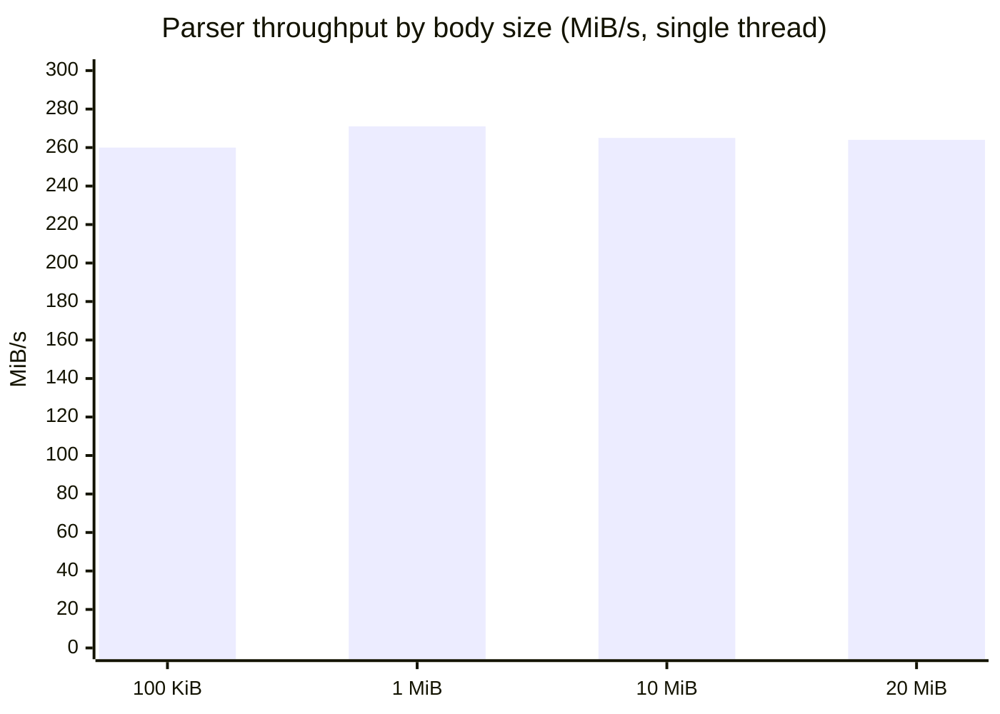
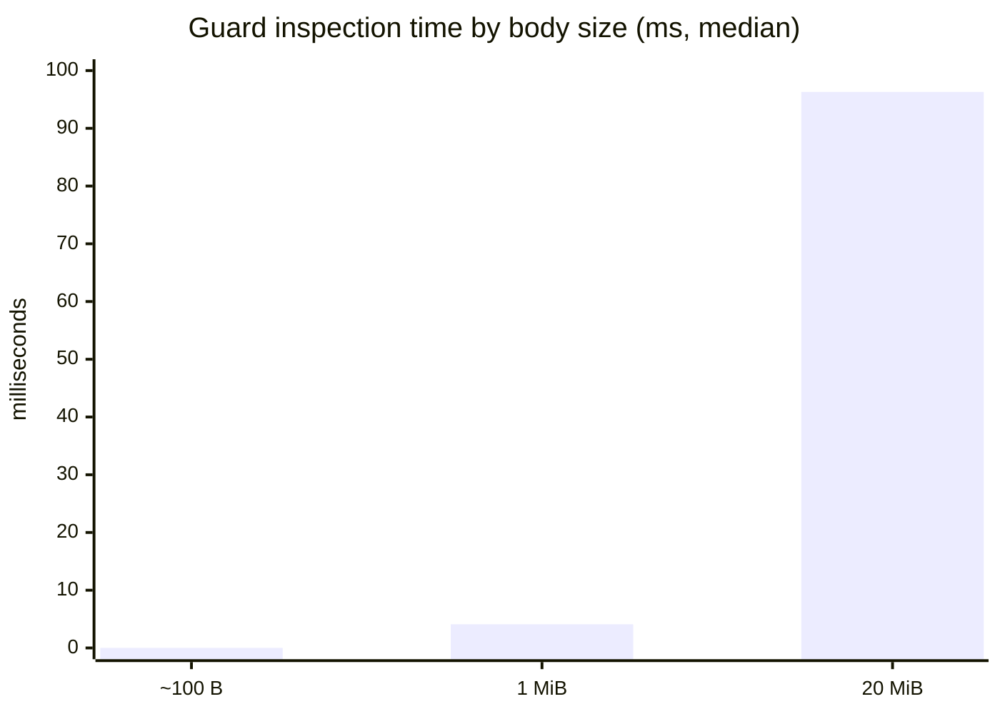
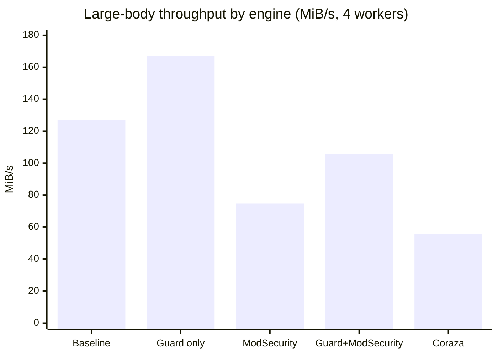
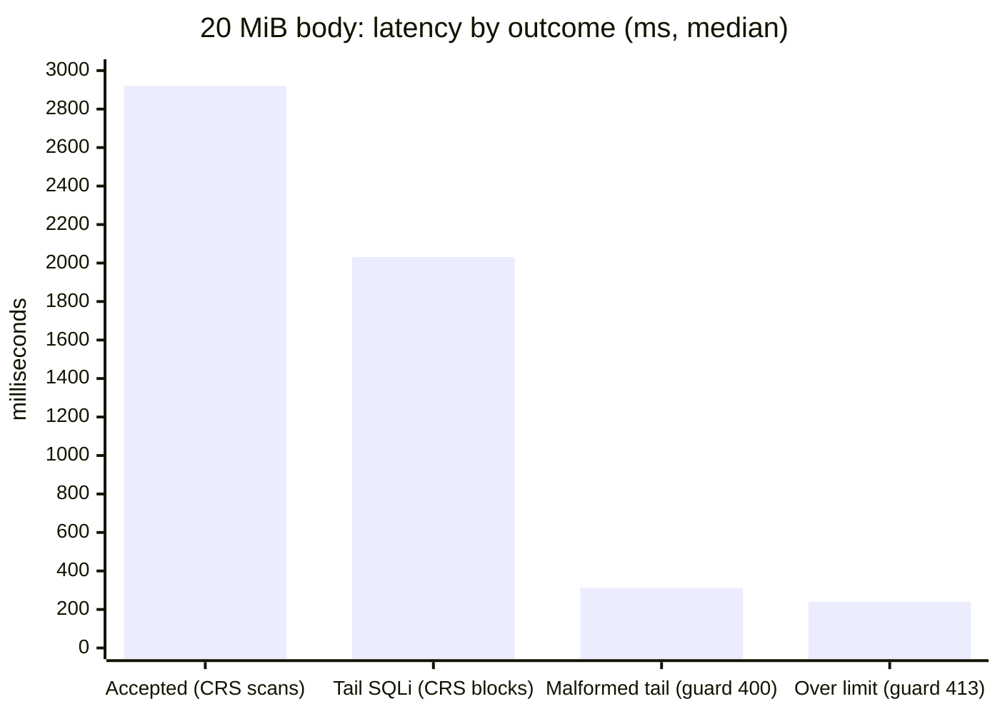

# Performance results

All numbers are from the fresh runs of 2026-08-24 (commit `08851ee`),
WAF containers constrained to 2 vCPU / 4 GiB. Full methodology, raw
tables, and reproduction steps: `BENCHMARK.md` in the repository root.
Treat cross-engine *ratios* as the signal — absolute values shift with
hardware.

## Parser micro-throughput

Standalone parser, single thread, median of 15 passes, idle host:

| Body | Median | Throughput |
|---|---:|---:|
| 92 B | &lt; 1 µs | — |
| 100 KiB | 0.38 ms | 260 MiB/s |
| 1 MiB | 3.7 ms | 271 MiB/s |
| 10 MiB | 37.8 ms | 265 MiB/s |
| 20 MiB | 75.7 ms | 264 MiB/s |



Throughput is flat in body size; memory is flat too — the parser state is
a fixed ~96 KiB regardless of the document.

## What the guard adds per request

Guard + ModSecurity + full CRS, 4 workers, 175/175 correct outcomes.
"Guard p50" is the module's self-reported inspection time
(`$json_guard_inspection_us`):

| Case | Guard p50 | Total p50 | Share |
|---|---:|---:|---:|
| Small JSON object (~100 B) | 0.01 ms | 46.8 ms | &lt; 0.1% |
| 1 MiB clean JSON | 4.1 ms | 77.3 ms | 5.3% |
| 20 MiB clean JSON | 96.3 ms | 2920 ms | 3.3% |
| 20 MiB, SQLi at tail (403 by CRS) | 82.9 ms | 2031 ms | 4.1% |



On an accepted 20 MiB body under full CRS, the guard's timer reports
**75.2 ms median — 0.67%** of the ModSecurity-only latency for the same
body. The tail-SQLi row is the point of the module: CRS still inspects
the entire document and blocks the attack at the far end.

## Engine throughput (processor suites)

32-request corpus dominated by 1–100 MiB JSON bodies, 4 workers:



The guard-only bar sits *above* baseline because this corpus contains
malformed and over-limit bodies that the guard rejects early — baseline
must proxy every byte. On a fully well-formed corpus the guard lands at or
slightly below baseline. The same early-rejection effect explains
guard+ModSecurity beating ModSecurity alone (105.8 vs 74.8 MiB/s).

## Early rejection economics

20 MiB bodies, median latency by outcome:

| Case | Outcome | Latency |
|---|---|---:|
| Clean, accepted (full CRS scan) | 200 | 2920 ms |
| Malformed tail | 400 by guard | **313 ms** |
| Token/cardinality over limit | 413 by guard | 241 ms (guard portion 3.5 ms) |
| SQLi at tail | 403 by CRS | 2031 ms |



The structural rejects are roughly **10x cheaper** than a full CRS scan —
that is the budget the guard spends on every accepted body (about 3–5%)
and saves on every rejected one.

## Reproduce

```bash
make test             # 75 parser unit tests
make bench-micro      # micro-throughput table above (~1 min, idle host)
make cross-waf-full   # 8 engine profiles (~90 min + image build)
make waf-correctness  # 21-case constrained run (~5 min)
make waf-perf         # 175-request mixed run (~10 min)
```

Reports and per-request JSON land under `artifacts/`. The runs quoted
here: `artifacts/cross-waf/20260824-004254/` and
`artifacts/waf-perf/20260824-0213{48,36}/`.
